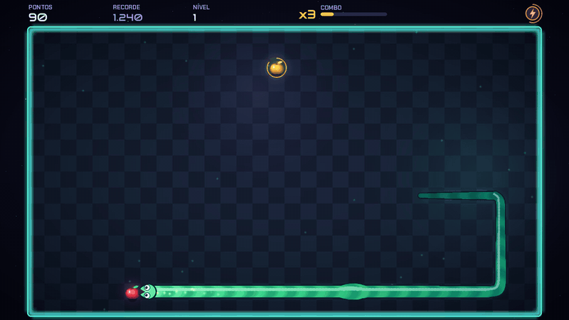
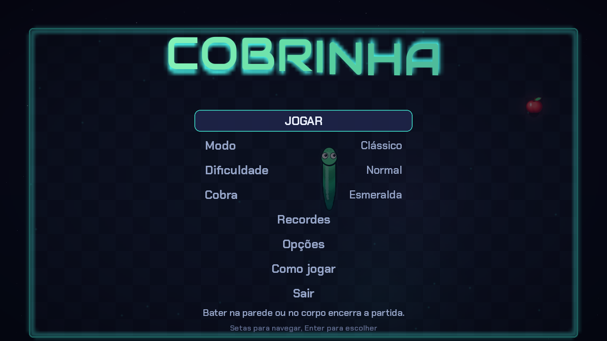
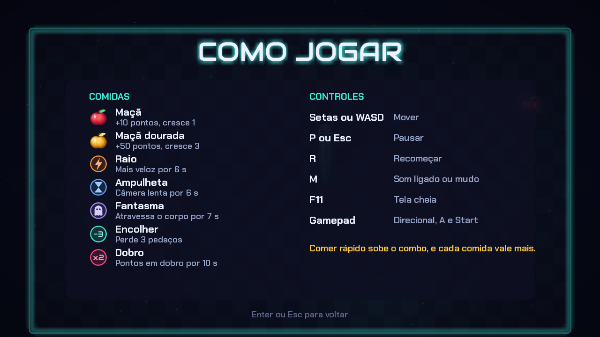
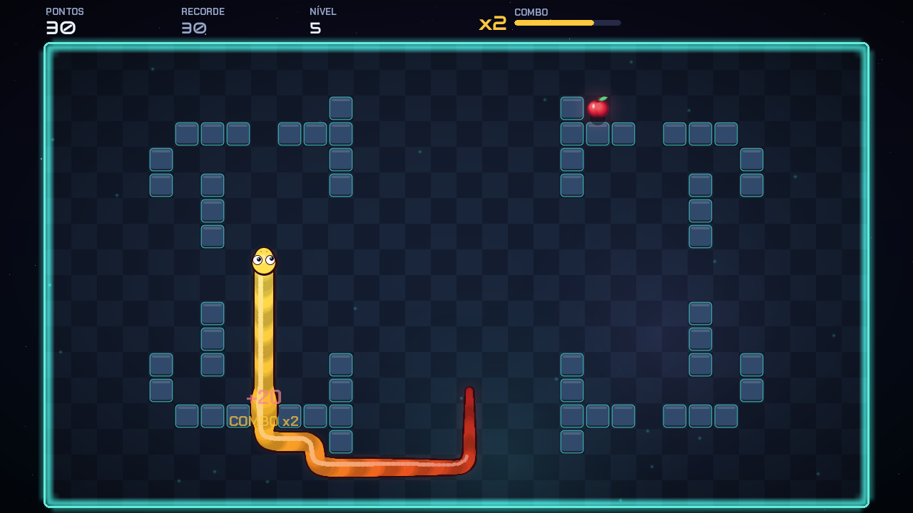
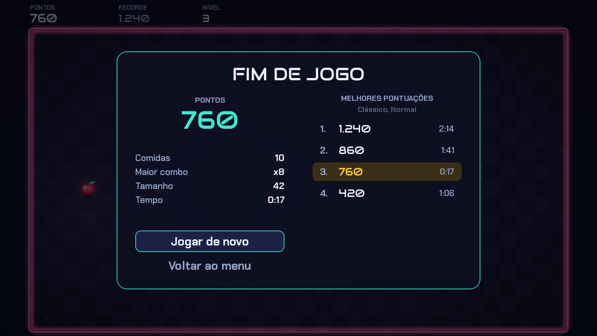

# Jogo da Cobrinha

Snake em Python com visual neon, animações suaves e música própria. Todos os gráficos e sons são gerados por código: o repositório não tem nenhuma imagem de sprite nem arquivo de áudio.



## Como rodar

Precisa de Python 3.10 ou mais novo.

```bash
git clone https://github.com/NicholassweetDev/Jogo-da-cobrinha.git
cd Jogo-da-cobrinha
python -m venv .venv
source .venv/bin/activate
pip install -r requirements.txt
python main.py
```

## Controles

| Tecla | Ação |
| --- | --- |
| Setas ou WASD | Mover a cobra e navegar nos menus |
| Enter ou Espaço | Confirmar |
| P ou Esc | Pausar |
| R | Recomeçar, na pausa ou no fim da partida |
| M | Ligar ou desligar o som |
| F11 | Tela cheia |
| F3 | Mostrar os FPS |

O menu também funciona com o mouse. No gamepad, use o direcional ou o analógico para mover, A para confirmar, B para voltar e Start para pausar. O jogo pausa sozinho quando a janela perde o foco.

## Modos

| Modo | Regra |
| --- | --- |
| Clássico | Bater na parede ou no corpo encerra a partida. |
| Sem paredes | Saia por um lado da arena e volte pelo outro. |
| Obstáculos | Novos muros surgem a cada nível, sem nunca dividir a arena. |
| Contra o tempo | Você começa com 60 segundos, e comer rende segundos extras. |

Cada modo tem 4 dificuldades: Fácil, Normal, Difícil e Insano. A velocidade sobe a cada 5 comidas, e a arena muda de cor a cada nível.

## Comidas

| Comida | Efeito |
| --- | --- |
| Maçã | 10 pontos, cresce 1 |
| Maçã dourada | 50 pontos, cresce 3 |
| Raio | Mais veloz por 6 segundos |
| Ampulheta | Câmera lenta por 6 segundos |
| Fantasma | Atravessa o próprio corpo por 7 segundos |
| Encolher | Perde 3 pedaços |
| Dobro | Pontos em dobro por 10 segundos |

As comidas especiais somem em 7 segundos e piscam antes disso. Comer rápido sobe o combo até x8, e o combo multiplica os pontos. O prazo do combo depende da distância até a comida, então vale ir direto em vez de torcer para ela nascer perto.

## O que tem no jogo

- Corpo contínuo com curvas suaves e movimento interpolado entre as células, em vez de saltos de quadrado em quadrado.
- Cobra com olhos que seguem a comida, língua, piscadas, boca que abre perto da comida e ondulação ao engolir.
- Partículas, ondas de choque, tremor de tela, pontos flutuantes e morte em câmera congelada, com o corpo explodindo pedaço por pedaço.
- 5 aparências para a cobra.
- Música em loop e 28 efeitos sonoros sintetizados na hora. A mordida fica mais aguda conforme o combo sobe.
- Fila de viradas, para duas teclas rápidas não se perderem.
- Tabela dos 5 melhores por modo e dificuldade, salva em `~/.config/cobrinha/dados.json`.
- Opções para desligar o tremor e os clarões da tela.

| | |
| --- | --- |
|  |  |
|  |  |

## Desenvolvimento

```bash
pip install -r requirements-dev.txt
python -m pytest
```

Os testes rodam sem janela nem som e jogam partidas inteiras com um piloto automático. Para gerar capturas de todas as telas:

```bash
python ferramentas/capturar.py capturas
```

A lógica do jogo fica em `cobrinha/nucleo` e não importa pygame. Ela avança em ticks fixos e emite eventos, aos quais o desenho e o som reagem.

```text
cobrinha/
  nucleo/    regras, cobra, comidas, obstáculos e piloto automático
  render/    tema, cobra, cenário, efeitos e barra de pontos
  cenas/     menu e partida
  audio/     síntese de som e reprodução
  app.py     janela, laço principal e transições
```

## Créditos

Fontes [Audiowide](https://fonts.google.com/specimen/Audiowide) e [Chakra Petch](https://fonts.google.com/specimen/Chakra+Petch), sob a licença SIL Open Font License. As licenças estão em `cobrinha/assets/fontes`.

## Licença

MIT. Veja o arquivo [LICENSE](LICENSE).
